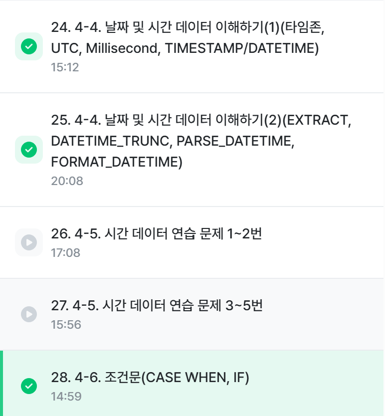
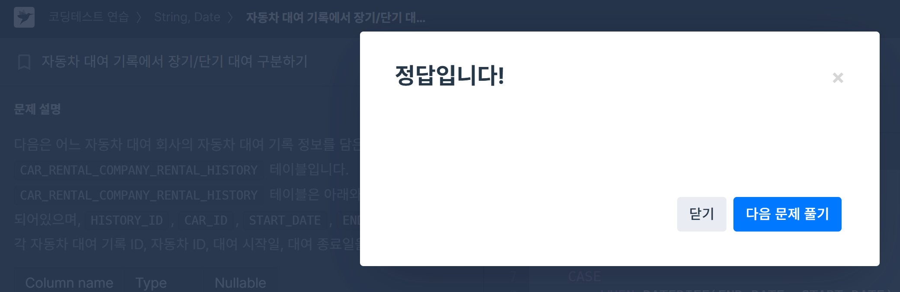
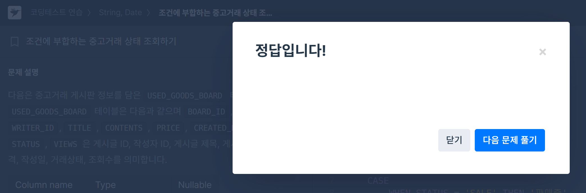

# 📘 SQL_BASIC 5주차 정규 과제

SQL_BASIC 정규 과제는 매주 정해진 분량의 `초보자를 위한 BigQuery(SQL) 입문` 강의를 듣고, 핵심 개념을 정리한 뒤 간단한 SQL 문제를 직접 풀어보는 방식으로 진행합니다.

이번 주는 날짜/시간 데이터와 조건문을 학습합니다. 특히 `CASE WHEN`은 SQL 문제 풀이와 데이터 분석에서 자주 사용되므로, 직접 분류 기준을 만들고 결과를 확인하는 연습을 해주세요.

완성된 과제는 Github에 업로드하고, 링크를 스프레드시트 'SQL' 시트에 입력해 제출해주세요.

**👀 수행 인증란은 필수입니다.**

---

## 📚 SQL_BASIC_5th_TIL

### 섹션 5. 데이터 탐색 - 변환

### 4-4. 날짜 및 시간 데이터 이해하기

### 4-6. 조건문(CASE WHEN, IF)

---

## ✨ 선택 강의

- 4-5. 시간 데이터 연습문제: 날짜/시간 함수를 더 연습하고 싶을 때 선택 수강
- 4-7. 조건문 연습문제: CASE WHEN과 IF를 더 연습하고 싶을 때 선택 수강

---

## 🏁 전체 강의 수강 계획

| 주차 | 필수 강의 범위 | 선택 강의 | 완료 여부 |
| --- | --- | --- | --- |
| 1주차 | 1-1 ~ 2-1 | 1 | ✅ |
| 2주차 | 2-2 ~ 2-3 | 2-4 | ✅ |
| 3주차 | 2-5, 2-7 ~ 2-8 | 2-6 | ✅ |
| 4주차 | 3-2 ~ 4-3 | 3-4 | ✅ |
| 5주차 | 4-4 ~ 4-6 | 4-5, 4-7 | ✅ |
| 6주차 | 5-2 ~ 5-5 | 5-6 | 🍽️ |
| 7주차 | 필수 강의 없음 | 6-2, 6-3, 6-4, 6-5 | 🍽️ |

---

<br>

<!-- 여기까진 그대로 둬 주세요-->

---

# 1️⃣ 개념 정리

아래 키워드 중 중요하다고 생각한 개념을 2개 이상 골라 짧게 정리해주세요. 3개보다 더 많이 정리하고 싶다면 자유롭게 항목을 추가해도 좋습니다.

이번 주 키워드:
- DATE
- DATETIME
- TIMESTAMP
- EXTRACT
- DATETIME_TRUNC
- FORMAT_DATETIME
- CASE WHEN
- IF

## 01.

```
개념 이름: 기본 시간 데이터 (DATE, TIME, DATETIME)
개념 설명: 기본적인 날짜 및 시간 데이터 타입으로, DATE는 날짜만, TIME은 시간만, DATETIME은 그 둘을 모두 포함하는 데이터이다. 
예시 쿼리: DATE(주어진 날짜) ... 
```

## 02.

```
개념 이름: TIMESTAMP
개념 설명: 1970년 1월 1일 00:00:00 UTC부터 특정 시점까지 경과한 시간으로 '1704176819711'처럼 초 단위 숫자로 표기된다. 
예시 쿼리:
SELECT
	TIMESTAMP_MILLIS(1704176819711) AS milli_to_timestamp_value,
	DATETIME(TIMESTAMP_MILLIS(1704176819711))) AS datetime_value,
	DATETIME(TIMESTAMP_MILLIS(1704176819711)), 'Asia/Seoul') AS datetime_value_asia;,
DATETIME vs TIMESTAMP:
T vs UTC / 한국존 사용 시 한국 시간과 동일 vs 한국 시간 -9시간
```

## 03.

```
개념 이름: CASE_WHEN / IF
개념 설명: '특정 조건 충족 시, 어떤 행동을 하자'라는 의미의 조건문을 실행 시 사용하는 함수. CASE_WHEN은 여러 조건이 있을 경우, IF는 단일 조건일 경우 더 유용하다. 다만 여러 조건일 경우 조건의 순서에 유의하자. 
문법:    
SELECT
	CASE
		WHEN 조건1 THEN 조건1이 참일 경우 결과
		WHEN 조건2 THEN 조건2가 참일 경우 결과
		ELSE 그 외 조건일 경우 결과
END AS 새로운_컬럼_이름
FROM ...

IF(조건문, True일 때의 값, False일 때의 값) AS 새로운_컬럼_이름
```


---

# 2️⃣ 수행 인증란

아래 중 하나 이상을 첨부해주세요.

- 강의 수강 화면 캡처
- 문제 풀이 정답 화면 캡처
- SQL 실행 결과 화면 캡처

---



# 3️⃣ 확인 문제

프로그래머스는 로그인이 필요하므로, 로그인 후 문제 풀이를 진행해주세요.

## 🧩 문제 1

문제 링크: [자동차 대여 기록에서 장기/단기 대여 구분하기](https://school.programmers.co.kr/learn/courses/30/lessons/151138)

풀이 과정:
```
SELECT
    HISTORY_ID,
    CAR_ID,
    DATE(START_DATE) AS START_DATE,
    DATE(END_DATE) AS END_DATE,
    CASE
        WHEN DATEDIFF(END_DATE, START_DATE) +1 >= 30 THEN '장기 대여'
        ELSE '단기 대여'
    END AS RENT_TYPE
FROM CAR_RENTAL_COMPANY_RENTAL_HISTORY
WHERE START_DATE >= '2022-09-01' AND START_DATE < '2022-10-01' 
ORDER BY HISTORY_ID DESC
```

```
- 장기/단기 대여를 나눈 기준: 대여 시작일이 2022년 9월에 속하는 대여 기록에 대해서 대여 기간이 30일 이상이면 '장기 대여' 그렇지 않으면 '단기 대여' 로 표시
- 사용한 날짜 계산 방식: WHERE에서 조건을 통해 9월 기간 내의 기록으로 한정하였고, DATEDIFF를 통해 장기 대여 기준을 작성했다. 다만 당일 빌리고 당일 반납해도 대여 기간이 1일이니 주의(+1)로 작성
- CASE WHEN으로 만든 컬럼: 장기 대여와 단기 대여를 구분
```



## 🧩 문제 2

문제 링크: [한 해에 잡은 물고기 수 구하기](https://school.programmers.co.kr/learn/courses/30/lessons/298516)

풀이 과정:
```
SELECT 
    COUNT(*) AS FISH_COUNT
FROM FISH_INFO
WHERE TIME >= '2021-01-01' AND TIME <= '2021-12-31'
```

```
- 문제에서 요구한 연도: 2021년 한 해
- 사용한 날짜 조건: WHERE 문에서 TIME 컬럼의 시간을 부등호를 통해 조건을 걸었다. 
- 집계한 대상: TIME 항목에서 2021년에 집계된 모든 데이터 * 대상
```


## 🧩 문제 3

문제 링크: [조건에 부합하는 중고거래 상태 조회하기](https://school.programmers.co.kr/learn/courses/30/lessons/164672)

풀이 과정:
```
SELECT
    BOARD_ID,
    WRITER_ID,
    TITLE,
    PRICE,
    CASE
        WHEN STATUS = 'SALE' THEN '판매중'
        WHEN STATUS = 'RESERVED' THEN '예약중'
        ELSE '거래완료'
    END AS STATUS
FROM USED_GOODS_BOARD
WHERE CREATED_DATE = '2022-10-05'
ORDER BY BOARD_ID DESC
```
 
```
- 날짜 조건: WHERE에서 등호를 통해 조건을 걸었다
- CASE WHEN으로 바꾼 값: STATUS에 기존에 입력된 값을 한글화하여야 했기에 각각 조건을 걸어 변환해 주었다.
- ELSE에 해당하는 경우: 3가지 status 상태 중 적히지 않은 done 상태
- 정렬 기준: 게시판 id를 기준으로 내림차순 (디폴트값이 아니니까 DESC!)
- 주의할 점: SQL 에서는 == 이거 안쓰고 무조건 = 등호 한 개만 쓴다 주의!!
```



## 🧩 문제 4

문제 링크: [자동차 평균 대여 기간 구하기](https://school.programmers.co.kr/learn/courses/30/lessons/157342)

풀이 과정:
```
SELECT 
    CAR_ID,
    ROUND(AVG(DATEDIFF(END_DATE, START_DATE) + 1), 1) AS AVERAGE_DURATION
FROM CAR_RENTAL_COMPANY_RENTAL_HISTORY
GROUP BY CAR_ID
HAVING AVG(DATEDIFF(END_DATE, START_DATE) + 1) >= 7
ORDER BY AVERAGE_DURATION DESC, CAR_ID DESC
```

```
- GROUP BY 기준: 차의 등록번호 기준으로 렌트 기록 분류
- 평균을 계산한 방식: AVG로 평균 계산, 소수점 한 자릿수 반영
- HAVING에 사용한 조건: 차의 등록번호에서 DAFEDIFF를 통해 대여 시작 시간과 반납 시간의 차를 구함. 당일대여 당일반납 주의로 +1
- 처음 헷갈렸던 점: +1 반영하는 점, 정렬순서가 여러 개일 경우 콤마 사용, HAVING 은 그냥 그룹 기준 WHERE과 동일 취급
```


---

# 4️⃣ 이번 주 회고

```
1. 날짜 함수 중 가장 헷갈린 함수: DATEDIFF와 DATETIME_DIFF 외에도... DATE나 TIME, DATETIME, TIMESTAMP 따라 조금씩 달라지는 듯
2. CASE WHEN을 사용할 때 기억해야 할 문법: END_AS를 잊지 말자. 문제3처럼 기존의 컬럼을 변형하는 식일 시에는 앞에서 기존 컬럼명을 적지 않기
3. 날짜/시간 데이터나 조건문을 활용해보고 싶은 분석 상황: 상품 판매 목록 등... 날짜별 실적 분석 상황
```

수고하셨습니다!


