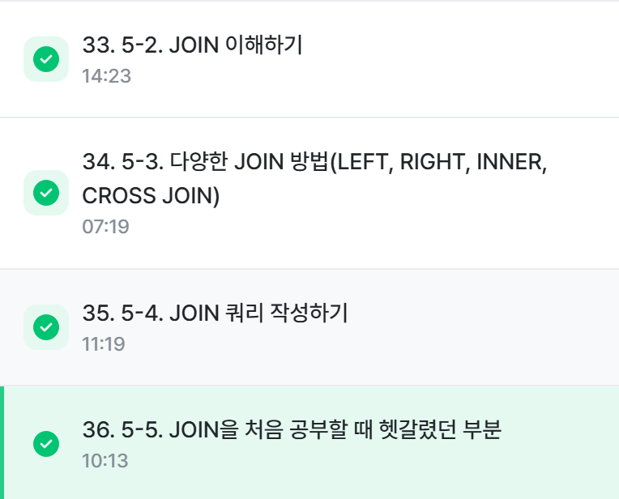
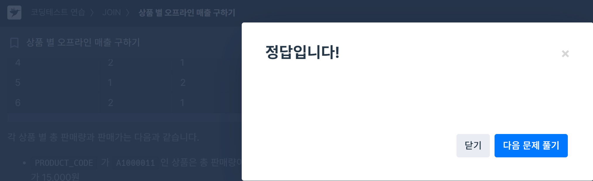
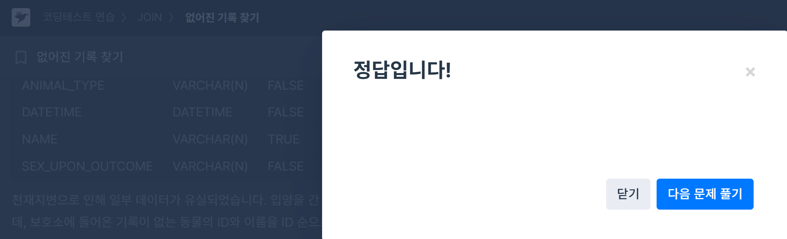

# 📘 SQL_BASIC 6주차 정규 과제

SQL_BASIC 정규 과제는 매주 정해진 분량의 `초보자를 위한 BigQuery(SQL) 입문` 강의를 듣고, 핵심 개념을 정리한 뒤 간단한 SQL 문제를 직접 풀어보는 방식으로 진행합니다.

이번 주는 SQL 입문 과정의 핵심 고비인 `JOIN`을 학습합니다.

JOIN은 여러 테이블을 연결해서 분석 질문에 답하기 위해 반드시 필요한 개념입니다. 이번 주 과제에서는 정답 코드뿐 아니라 **어떤 테이블을 어떤 키로 연결했는지**를 꼭 기록해주세요.

완성된 과제는 Github에 업로드하고, 링크를 스프레드시트 'SQL' 시트에 입력해 제출해주세요.

**👀 수행 인증란은 필수입니다.**

---

## 📚 SQL_BASIC_6th_TIL

### 섹션 6. 다량의 자료를 연결 : JOIN

### 5-2. JOIN 이해하기

### 5-3. 다양한 JOIN 방법

### 5-4. JOIN 쿼리 작성하기

### 5-5. JOIN을 처음 공부할 때 헷갈리는 부분

---

## ✨ 선택 강의

- 5-6. JOIN 연습문제: JOIN 문제를 더 연습하고 싶을 때 선택 수강

---

## 🏁 전체 강의 수강 계획

| 주차 | 필수 강의 범위 | 선택 강의 | 완료 여부 |
| --- | --- | --- | --- |
| 1주차 | 1-1 ~ 2-1 | 1 | ✅ |
| 2주차 | 2-2 ~ 2-3 | 2-4 | ✅ |
| 3주차 | 2-5, 2-7 ~ 2-8 | 2-6 | ✅ |
| 4주차 | 3-2 ~ 4-3 | 3-4 | ✅ |
| 5주차 | 4-4 ~ 4-6 | 4-5, 4-7 | ✅ |
| 6주차 | 5-2 ~ 5-5 | 5-6 | ✅ |
| 7주차 | 필수 강의 없음 | 6-2, 6-3, 6-4, 6-5 | 🍽️ |

---

<br>

<!-- 여기까진 그대로 둬 주세요-->
지각제출하였습니다. 
---

# 1️⃣ 개념 정리

아래 키워드 중 중요하다고 생각한 개념을 2개 이상 골라 짧게 정리해주세요. 3개보다 더 많이 정리하고 싶다면 자유롭게 항목을 추가해도 좋습니다.

이번 주 키워드:
- JOIN
- INNER JOIN
- LEFT JOIN
- JOIN key
- alias
- NULL
- 다중 JOIN

## 01.

```
개념 이름: JOIN
개념 설명: 기본적으로 서로 다른 데이터 테이블을 연결하는 것. 다양한 종류가 있으며, 공통적으로 존재하는 컬럼인 Key를 가지고 JOIN된다. 주로 id가 많이 이 Key로 쓰이게 됨(다른 범위도 가능)
예시 쿼리: FROM 하단에 JOIN할 Table을 작성하고 ON 뒤에 공통된 컬럼(Key) 작성
```
```
ex. 

SELECT
	A.col1,
	A.col2,
	B.col11,
	B.col12
FROM table1 AS A # AS 는 그냥 전에도 나왔던 별칭 지정
LEFT JOIN table2 AS B
ON A.key = B.key # 테이블 이름이 길 수 있기 때문에 별칭(Alias)정의 가능)

# 당근 위에서 쓰인 col, table, key 다 실제 데이터셋에서 그 이름으로 써주기 
```

## 02.

```
개념 이름: JOIN의 종류
개념 설명: INEER JOIN, LEFT/RIGHT JOIN, FULL JOIN, CROSS JOIN 등의 종류가 있음
상세 설명:
- INNER JOIN: 두 테이블의 공통 요소만 연결 ; 교집합
- LEFT/RIGHT JOIN: 한 테이블을 기준 테이블로 정하고 나머지 테이블에서 필요한 것만 연결 ; A집합, B집합 그 자체
- FULL JOIN: 그냥 다 갖다 붙이기 ; 합집합
- CROSS JOIN: 행렬에서 곱하기할 때랑 똑같은 과정을 해주면 됨. 행x열 다 곱하기
```

## 03.

```
개념 이름: NULL
개념 설명: 0이나 공백과는 다르게 값이 아예 없는 것. 휴지를 다 써서 심지만 남은 상태가 아니라 그냥 휴지심 자체가 꽂아지지 않은 상태. JOIN할 때 자주 등장할 수 있음.
헷갈린 점: LEFT/RIGHT JOIN을 할때 합쳐주고 NULL을 없애주는 과정을 통해 둘이 서로 같아질 수 있음.
```

---

# 2️⃣ 수행 인증란

아래 중 하나 이상을 첨부해주세요.

- 강의 수강 화면 캡처
- JOIN 문제 풀이 정답 화면 캡처
- JOIN 전후 결과 row 수를 비교한 캡처 또는 메모



---

# 3️⃣ 확인 문제

프로그래머스는 로그인이 필요하므로, 로그인 후 문제 풀이를 진행해주세요.

## 🧩 문제 1

문제 링크: [조건에 맞는 도서와 저자 리스트 출력하기](https://school.programmers.co.kr/learn/courses/30/lessons/144854)

풀이 과정:
```
SELECT
	BOOK.BOOK_ID,
	AUTHOR.AUTHOR_NAME,
	BOOK.PUBLISHED_DATE
FROM BOOK
LEFT JOIN AUTHOR
ON BOOK.AUTHOR_ID = AUTHOR.AUTHOR_ID
WHERE BOOK.CATEGORY = '경제'
ORDER BY BOOK.PUBLISHED_DATE
```

```
- 사용한 테이블: 기준 테이블은 BOOK
- JOIN key: 두 Table 모두에서 AUTHOR_ID
- 날짜를 출력한 형식: ORDER BY 했는데 오름차순일 경우 ASC 지만 불필요. BUT 내림차순일 경우 DESC 필수로 적어주기
- 헷갈렸던 점: 
1. 이제는 여러 개의 테이블을 다루니까 컬럼명만 쓰지 말고 꼭 [테이블.컬럼명] 구조로 써주기
2. SELECT - FROM - JOIN - ON - WHERE 의 순서. FROM 다음에 JOIN이 와야하므로 WHERE로 조건을 경우 그 JOIN 과정 끝나고 써야된다는 점!!
```


## 🧩 문제 2

문제 링크: [상품 별 오프라인 매출 구하기](https://school.programmers.co.kr/learn/courses/30/lessons/131533)

풀이 과정:
```
SELECT
	PRODUCT.PRODUCT_CODE,
	SUM(PRODUCT.PRICE*OFFLINE_SALE.SALES_AMOUNT) AS SALES
FROM PRODUCT
JOIN OFFLINE_SALE 
ON PRODUCT.PRODUCT_ID = OFFLINE_SALE.PRODUCT_ID
GROUP BY PRODUCT.PRODUCT_CODE
ORDER BY SALES DESC, PRODUCT_CODE
```

```
- 연결한 테이블: 기준 테이블은 PRODUCT
- JOIN key: 두 Table 모두에서 PRODUCT_ID
- 집계한 값: SUM(PRODUCT.PRICE*OFFLINE_SALE.SALES_AMOUNT) AS SALES
- 헷갈렸던 점:
1. SALES 라는 새로운 컬럼을 만들 때 'SALES=~' 사용하지 않기. =는 논리문에서 쓰인다. [식 AS 컬럼명] 을 기억하자.
2. 또한, 이렇게 계산을 통해서 새로운 컬럼을 추가할 경우 앞에 SUM을 통해 전체 행에 대하여 계산할 수 있게 해야한다.
3. 앞선 WHERE은 조건에 맞은 데이터를 추출해내는 것이고, GROUP BY는 종류별로 묶는 역할이다.
4. ORDER BY 해줄 때 콤마로 다음 기준 바로 작성 가능. 각 기준마다 ASC, DESC 생각하기.
```



## 🧩 문제 3

문제 링크: [없어진 기록 찾기](https://school.programmers.co.kr/learn/courses/30/lessons/59042)

풀이 과정:
```
SELECT
    ANIMAL_OUTS.ANIMAL_ID,
    ANIMAL_OUTS.NAME
FROM ANIMAL_OUTS
LEFT JOIN ANIMAL_INS
ON ANIMAL_OUTS.ANIMAL_ID = ANIMAL_INS.ANIMAL_ID
WHERE ANIMAL_INS.ANIMAL_ID IS NULL
```

```
- 기준이 되는 왼쪽 테이블: ANIMAL_OUTS
- LEFT JOIN이 필요한 이유: ANIMAL_OUTS을 기준으로 채우고 INS에서 없는 애를 골라야 하니까
- NULL이 발생하는 경우: INS의 정보가 소실되었으므로 보호소로 온 동물들의 ID가 빠져있다.
- 헷갈렸던 점:
1. 테이블이 오른쪽에 있다고 오른쪽이 아니라... 기준 테이블 기준이다.
2. IS NULL 을 통해서 NULL 행 찾기 가능
```



## 🧩 문제 4

문제 링크: [있었는데요 없었습니다](https://school.programmers.co.kr/learn/courses/30/lessons/59043)

풀이 과정:
```
SELECT
    ANIMAL_INS.ANIMAL_ID,
    ANIMAL_INS.NAME
FROM ANIMAL_INS
LEFT JOIN ANIMAL_OUTS
ON ANIMAL_INS.ANIMAL_ID = ANIMAL_OUTS.ANIMAL_ID
WHERE ANIMAL_INS.DATETIME > ANIMAL_OUTS.DATETIME
ORDER BY ANIMAL_INS.DATETIME
```

```
- 사용한 테이블: 기준 테이블은 ANIMALS_INS
- JOIN key: 두 테이블 모두에서 ANIMAL_ID
- 비교한 날짜 컬럼: 두 테이블 모두에서 DATETIME
- 정렬 기준: ANIMAL_INS.DATETIME
- 헷갈렸던 점:
1. 두 테이블 각각의 DATETIME의 데이터타입이 모두 DATETIME이기 때문에 그냥 변환 없이 비교연산자로 논리문 체크할 수 있었다.
2. 출력 컬럼이 아니어도 출력 순서로 쓰일 수 있구나.
```


---

# 4️⃣ 참고 자료

JOIN 개념이 헷갈린다면 아래 자료를 함께 참고해도 좋습니다.

1. https://data-marketing-bk.tistory.com/entry/SQL-JOIN-%ED%95%9C-%EB%B0%A9%EC%97%90-%EC%A0%95%EB%A6%AC-%EA%B0%9C%EB%85%90%EB%B6%80%ED%84%B0-%EC%BD%94%EB%93%9C%EA%B9%8C%EC%A7%80-%EC%9D%B4%EA%B2%83%EB%A7%8C-%EB%B3%B4%EC%9E%90
2. https://velog.io/@wijoonwu/JOIN

---

# 5️⃣ 이번 주 회고

```
1. INNER JOIN과 LEFT JOIN의 차이를 어떻게 이해했는지: 교집합 내용을 포함한다는 것은 같지만, LEFT JOIN은 기준테이블에만 포함되는 내용도 담는다는 것.
2. JOIN 문제를 풀 때 가장 먼저 확인해야 할 것: 각 변수가 어디의 테이블에 들어가는지, 두 테이블을 합칠 Key가 무엇인지
3. JOIN 결과가 예상과 달랐던 경험이 있다면: 아직 JOIN의 결과가 달라진 적은 없으나 기타 함수들을 잘못 써서 결과 출력 자체에 문제가 계속 생겼다. JOIN의 순서와 기준 테이블, 키에 집중하고 이외의 문법도 잘 적자.
```

수고하셨습니다!


